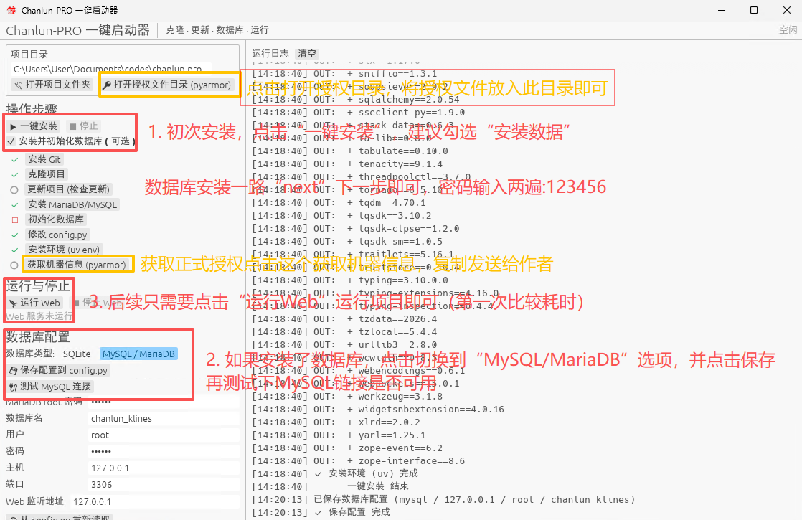

### Windows 安装文档

---

### AI 自动安装（复制提示词给 AI）

配套 AI 安装文档：<https://gitee.com/wang-student/chanlun-pro/raw/master/AI-INSTALL.md>

把下面整段提示词复制给具备终端与文件操作能力的 AI（如 Claude Code、Cursor、Codex），它会自动完成安装、启动与验收：

```text
请阅读并严格遵守以下安装文档，在我的机器上安装并运行 chanlun-pro：
https://gitee.com/wang-student/chanlun-pro/raw/master/AI-INSTALL.md

我的环境：Windows 10/11 x64

执行要求：
1. 先完整阅读文档，按 Gate 0 → Gate 6 顺序执行，每道 Gate 验收通过后再继续；
2. 开工前先向我确认文档 §2.4 的 5 个问题（授权文件、访问范围、端口、数据库、是否常驻）；
3. 授权文件 src/pyarmor_runtime_005445/pyarmor.rkey 必须由我提供；缺失时停下来向我要，不要伪造或绕过；
4. 安装完成后按文档 §5 验收，并把访问地址、启动命令、日志位置、验收结果发给我；
5. 遇到文档 §7 排查表解决不了的问题，把完整报错和已执行命令发给我；不要修改核心加密代码。
```


---

### [B站安装教程](https://www.bilibili.com/video/BV1XH4y1K7VM/)

### Chanlun-PRO Windows 启动器 下载与教程

> 启动器针对于不会 Python 与部署的小伙伴，鼠标点点即可进行使用。    
> 下载地址：    
>     链接: https://gitee.com/wang-student/chanlun-pro/releases/download/chanlun-launcher/chanlun-launcher.zip     
 
 
 
---

> Python 版本支持 3.11 3.12 3.13 3.14 ，不然运行会报 RuntimeError 错误  

> ### pytdx 必须使用项目目录 package 下提供的包进行安装


## 加作者微信，获取授权许可文件，并放置在项目中的 `src/pyarmor_runtime_005445` 目录下


### 1. 通过 Git 克隆项目到本地 或者 直接打包下载到本地 

> 两个地址项目是同步的，国内的可选 Gitee 国外的可选 GitHub （请帮忙给一个 Star）

      # GitHub 地址
      https://github.com/yijixiuxin/chanlun-pro
      # Gitee 地址
      https://gitee.com/wang-student/chanlun-pro
      # AtomGit 地址
      https://atomgit.com/zixisecai/chanlun-pro


### 2. 在 `chanlun-pro` 目录，双击 `windows_install.bat` 文件进行安装

### 3. 在 `chanlun-pro` 目录，双击 `windows_run.bat` 运行项目


> 如果 `windows_run.bat` 文件无法运行，请使用命令行运行
> 
> 在项目目录下右键，选择“在终端中打开”，然后输入如下命令启动项目：
> 
> .\script\bin\uv.exe run web\chanlun_chart\app.py


---
---
---

### 通过以上方式可以正常运行，就不用看下面了
### 以下是手动安装的命令


### 设置 PYTHONPATH 环境变量 （开发环境需要，如果只是运行 Web 服务则无需这步）

         # 我的电脑 -> 右键菜单选“属性” -> 高级系统设置 -> 高级 -> 环境变量 -> 系统变量 -> 新建
         # 系统变量信息，project_path 需要替换成项目所在目录
         变量名：PYTHONPATH
         变量值：\你的项目代码路径\chanlun-pro\src
         
         设置完成后，重启终端 ，输入命令 $env:PYTHONPATH  查看是否设置成功

### 在 `src/chanlun` 目录， 复制拷贝 `config.py.demo` 文件为 `config.py` 并修改其中的 [配置项](config-file-explained.md)

UV 和 Conda 任选一个自己喜欢的就行

### UV 安装命令

      # 安装 uv
      powershell -ExecutionPolicy ByPass -c "irm https://astral.sh/uv/install.ps1 | iex"
      
      # 进入 chanlun-pro 目录，创建虚拟环境，安装依赖包
      cd \你的项目代码路径\chanlun-pro
      
      # 同步环境依赖
      uv sync

      # 运行 Web 服务
      uv run web/chanlun_chart/app.py

### Conda 安装命令

      # 创建项目运行 Python 环境
      conda create -y -n chanlun python=3.11
      # 切换到新创建的 chanlun 环境  
      conda activate chanlun

      # PIP 安装项目依赖包
      pip3 config set global.index-url https://mirrors.aliyun.com/pypi/simple/
      pip3 install package/pytdx-1.72r2-py3-none-any.whl
      pip3 install package/ta_lib-0.8.0-cp311-cp311-win_amd64.whl
      pip3 install -r requirements.txt

      # 运行 Web 服务
      python web/chanlun_chart/app.py
      